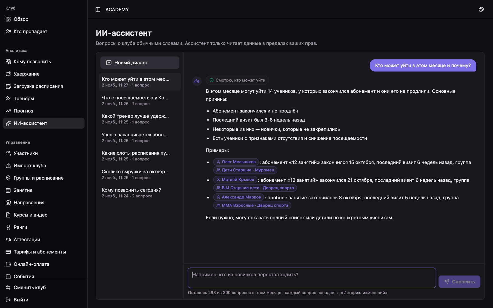
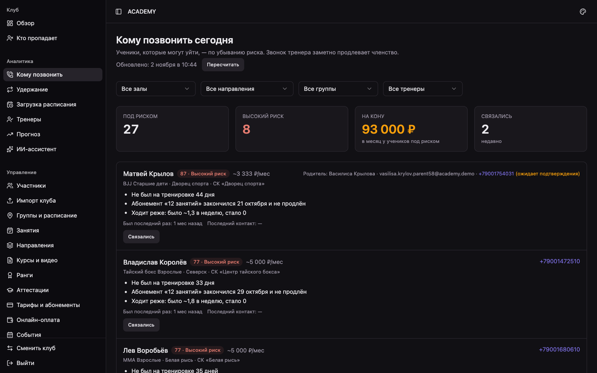
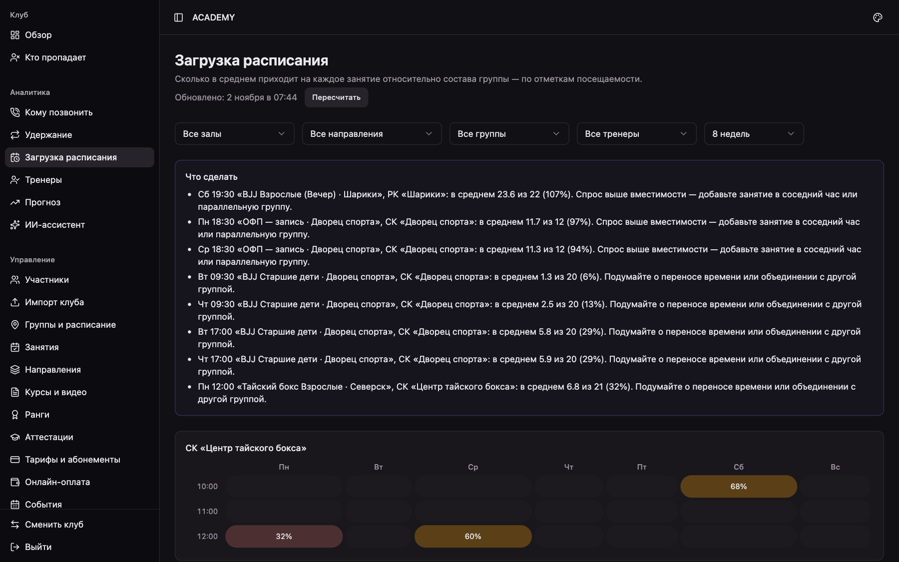
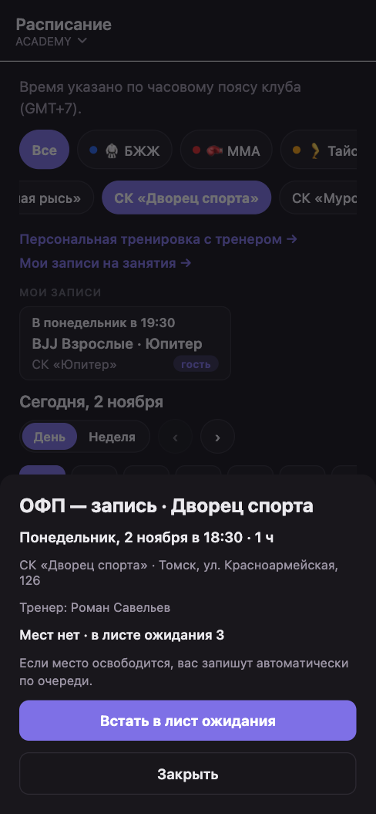
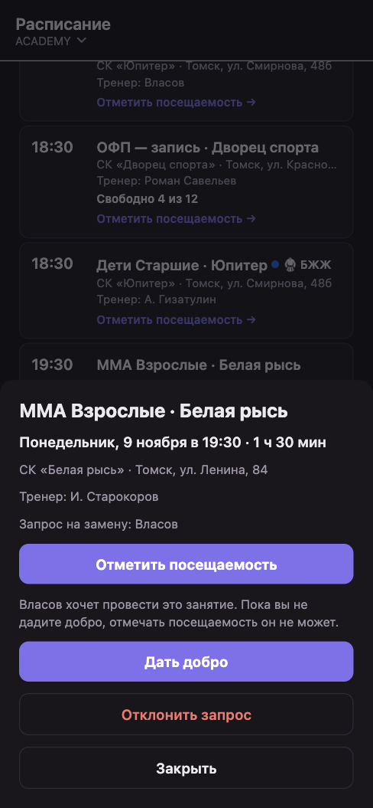
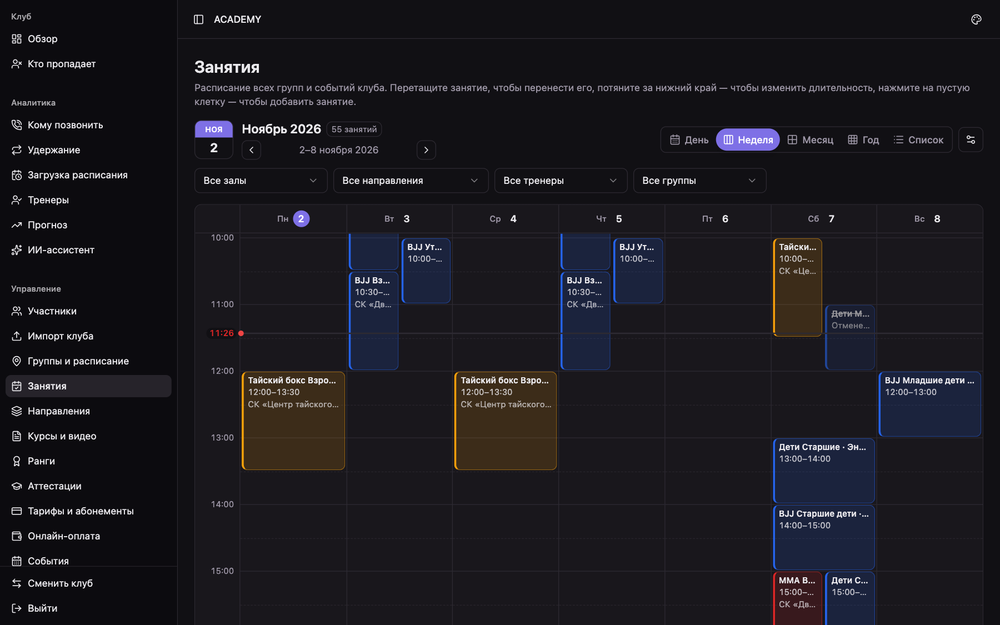
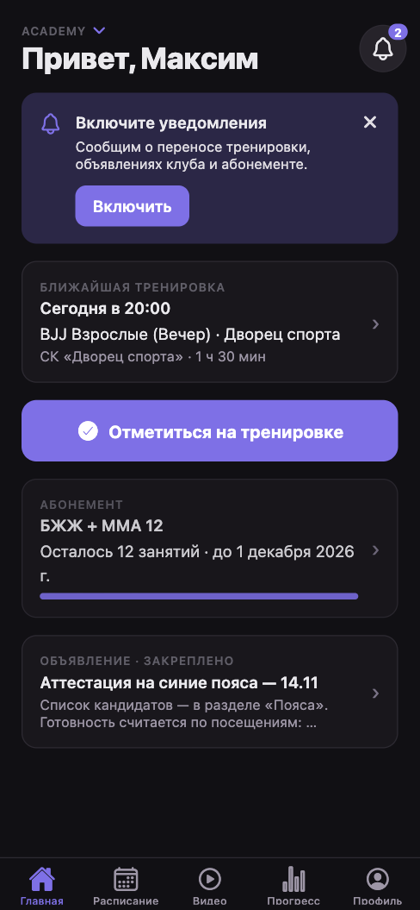
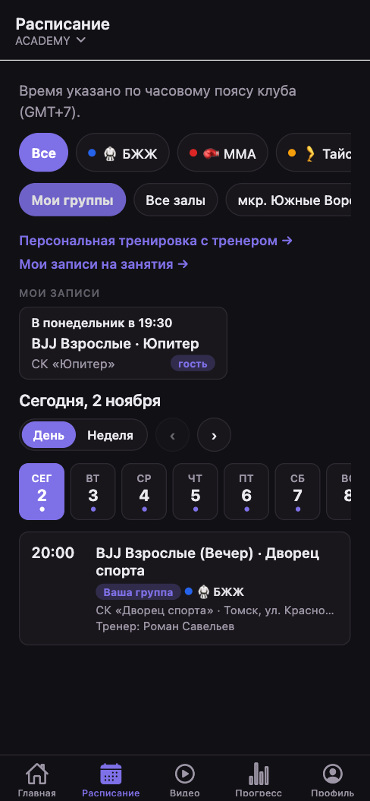

# ClubSpace — продажи клубам: сценарии, тексты, возражения

Цель первых 8 недель: 50 разговоров → 15 показов → 10 платящих клубов.
Кому продаём: клубы единоборств, фитнеса и йоги на 30–150 активных учеников, владелец сам тренирует или рядом с залом;
учёт в Excel, тетради, чатах WhatsApp/Telegram, либо платят за Mobifitness / 1С и недовольны.

Состав кита: этот файл (сценарии, возражения, цены), `onepager.html` — лист для клиента на 3 страницы A4 (продукт, новое со скриншотами, цены),
`screens/` — скриншоты демо-клуба ACADEMY (ноябрь 2026: админка 1440×900, приложение 390×844).

PDF листа собирается из `onepager.html`: открыть файл в Chrome → «Печать» → «Сохранить как PDF», A4,
поля «По умолчанию», включить «Фон». Готовый PDF в репозиторий не кладём.

## 1. Оффер для пилотов (первые 10 клубов)

- 30 дней пробного периода со всеми модулями.
- Плюс 2 месяца бесплатно (промо «2 месяца бесплатно» в консоли).
- Подключение бесплатно: переносим базу из Excel через «Импорт клуба», заводим расписание, тарифы и пояса, печатаем QR-постер.
- Взамен: раз в 2 недели 15-минутный созвон «что мешает» и отзыв, если понравится.
- После пилота — обычная цена по ступени (подключение для пилотов бесплатно — это спецусловие, обычно 4 990 ₽ один раз). Год вперёд — скидка 15%.

## 2. Первое сообщение

**Знакомому тренеру / владельцу:**
> Привет! Сделал приложение для клубов: расписание, отметка посещений с телефона, абонементы и долги, пояса и аттестации, видео для учеников — всё в одном. Мой клуб уже на нём. Могу за 15 минут показать вживую, заеду с телефоном. Когда удобно на этой неделе?

**Холодное (2ГИС, Instagram, VK):**
> Здравствуйте! Меня зовут ___, я сам тренируюсь в ___ и сделал ClubSpace — приложение для клуба: тренер отмечает занятие за минуту, ученик видит свой абонемент, пояс и расписание, владелец — кто перестал ходить и у кого долг. Первым клубам подключаю бесплатно и переношу базу из Excel сам. Можно заехать на 15 минут и показать на телефоне?

**После турнира / семинара:**
> Привет, виделись на ___. Помнишь, говорили про учёт в клубе — вот, показываю, что сделал: ___ (ссылка на сайт). Если интересно, приеду с телефоном и покажу на вашем примере.

## 3. Звонок или первые 5 минут встречи — вопросы

1. Сколько у вас активных учеников и залов? Какие направления?
2. Как сейчас ведёте расписание, посещаемость и абонементы? Кто это делает и сколько времени уходит?
3. Как узнаёте, что человек перестал ходить или не продлил абонемент?
4. Как ученики узнают о переносах и новостях? Сколько у вас чатов?
5. Пояса и аттестации — где хранится история, как решаете, кто готов?

Запоминайте боль клиента и показывайте на демо именно её.

## 4. Демо на 15 минут

Сценарий с ролями и экранами — `docs/demo.md` в репозитории. Перед встречей: «Сбросить демо» в консоли, проверить роли на телефонах.
Порядок: владелец (3 мин: обзор, «Кому позвонить», ИИ-ассистент — спросить «Кто может уйти в этом месяце и почему?»)
→ тренер на телефоне (3 мин: отметка за 3 тапа, замена «Дать добро», аттестация)
→ клиент сам сканирует QR-постер и «вступает» в демо-клуб (2 мин) → ученик (3 мин: запись на занятие / лист ожидания, абонемент, пояс, видео)
→ родитель (1 мин: «Я / ребёнок») → календарь «Занятия» и импорт (2 мин) → цена и пилот (2 мин).

## 4а. Что нового показать (ноябрь)

Говорим языком владельца: что это даёт клубу, а не как устроено.

- **ИИ-ассистент в админке.** Спрашиваете обычными словами — «Кто может уйти в этом месяце и почему?», «Какие залы пустуют?» —
  и через полминуты получаете ответ с именами и причинами. Он только смотрит данные, ничего не меняет, каждый вопрос виден в истории.
  
- **«Аналитика».** «Кому позвонить сегодня» — список учеников, которые могут уйти, с причиной («не был 33 дня», «абонемент
  не продлён») и суммой, которую клуб теряет. «Загрузка расписания» — какие занятия переполнены, а какие стоят полупустыми,
  и что с этим сделать. По понедельникам — короткая сводка на почту.
   
- **Запись на занятие с листом ожидания.** Для групп без постоянного состава (ОФП, открытые тренировки): ученик сам записывается,
  если мест нет — встаёт в очередь, освободилось место — его записывают автоматически. Поздняя отмена списывает занятие.
  
- **Замены тренеров.** Тренер заболел — назначаете замену в два касания, ученики видят «Замена: Р. Савельев». Тренер может сам
  попроситься провести чужое занятие, главный тренер даёт добро с телефона.
  
- **Календарь «Занятия».** Всё расписание клуба на неделю или месяц; перенести занятие — перетащить мышкой, продлить — потянуть край.
  
- **Видео без интернета.** Ученик заранее скачивает урок и смотрит в зале или в дороге, где нет связи.
- **Веб-приложение без установки + уведомления.** Ученик открывает ссылку, добавляет на экран телефона — и всё, ничего не скачивать
  из магазина. Уведомления о переносах, записи и абонементе приходят как от обычного приложения.
   

Остальные скриншоты: `screens/admin-overview.png` (обзор клуба: выручка, абонементы, долги), `screens/admin-analytics.png`
(раздел «Аналитика»), `screens/pwa-coach-home.png` (главная тренера: «Сегодня вы ведёте», кому позвонить, заявки на заморозку).

## 5. Возражения

| Говорят | Отвечаем |
|---|---|
| «У нас всё в Excel, нас устраивает» | Excel не напомнит ученику, что абонемент кончается, и не покажет, кто перестал ходить. Перенесём ваш Excel за вечер — сравните месяц. |
| «Дорого» | Для клуба на 80 учеников 5 990 ₽ — это около 1,5% выручки, дешевле двух абонементов в месяц. Удержите одного-двух учеников, которые собирались уйти («Кому позвонить» подскажет, кого), — и система окупилась. |
| «Ученики не поставят приложение» | Ставить не обязательно: работает и в браузере. Вступление — сканом QR на ресепшене, 30 секунд. Тренер отмечает всех сам. |
| «Мы берём наличными» | Это нормально: тренер отмечает «оплачено наличными». Онлайн-оплата — отдельный модуль, только если захотите. |
| «У нас уже Mobifitness / 1С» | Что не нравится? Покажу, как у нас: одно приложение на все клубы человека, пояса и видео по поясу, направления. Перенесём данные выгрузкой. |
| «А если вы закроетесь?» | Данные выгружаются в CSV в любой момент, договор-оферта и поручение на обработку данных — на сайте. |
| «iPhone?» | Работает в приложении и в браузере Safari: открыть ссылку и добавить на экран «Домой» — ставить из магазина не нужно. |
| «Нет времени этим заниматься» | Подключение делаю я: импорт, расписание, тарифы, постер. От вас — 30 минут показать тренерам. |

## 6. Цена — примеры для разговора

Источник цифр — тарифы в коде биллинга (`platform-pricing.config.ts`) и страница цен на сайте.

| Ступень | Активных учеников | В месяц |
|---|---|---|
| Старт | до 50 | 2 990 ₽ |
| Клуб | до 100 | 5 990 ₽ |
| Про | до 200 | 9 990 ₽ |
| Бизнес | до 400 | 16 990 ₽ |
| Сеть | больше 400 | 16 990 ₽ + 35 ₽ за каждого сверх 400 |

| Клуб | Ступень | В месяц | Это от выручки при абонементе 5 000 ₽ |
|---|---|---|---|
| 40 учеников | Старт | 2 990 ₽ | 1,5% |
| 80 учеников | Клуб | 5 990 ₽ | 1,5% |
| 150 учеников | Про | 9 990 ₽ | 1,3% |
| 300 учеников | Бизнес | 16 990 ₽ | 1,1% |
| 600 учеников, 10 залов | Сеть | 16 990 + 35 × 200 = 23 990 ₽ | 0,8% |

Модули по желанию: «Видео» 990 ₽ (20 ГБ и 100 часов просмотра в месяц), «Онлайн-оплата» 490 ₽, «Бренд-приложение» 2 990 ₽.
Пробный период — 30 дней со всеми модулями. Подключение — 4 990 ₽ один раз, с первым платежом (для пилотов бесплатно).
Год вперёд — −15% (на подключение скидка не действует).

## 7. Подключение клуба за один день

1. Клуб создаётся в консоли (или сам на сайте «Попробовать 30 дней»), владелец принимает оферту.
2. Промо для пилота: «2 месяца бесплатно».
3. Залы, направления, группы, расписание.
4. Тарифы (абонементы на наборы направлений), пояса.
5. «Импорт клуба»: выгрузка учеников из Excel → CSV → предпросмотр → загрузка.
6. QR-постер на ресепшен, ссылка-приглашение в чаты клуба.
7. 30 минут с тренерами: отметка посещаемости, аттестация.
8. Через 2 недели созвон: сколько учеников в приложении, что мешает.
